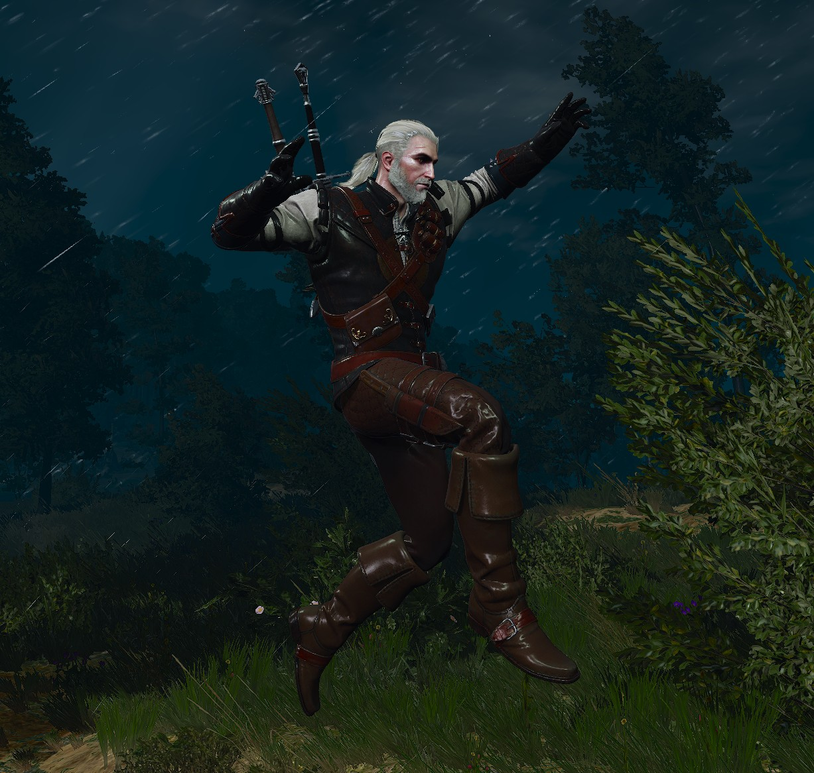

# Witcher 3 Remastered Bunny Hop

- Adds bunny hopping to The Witcher 3 Remastered.
- Requires GFP Camera mod to work, since it requires first person view.
- Hold the jump button to autobhop.
- Air strafing follows Half-Life 1.

## Controls
Press P to toggle between third/first person modes (only available in packed install).
If using manual install, you can bind the key for toggling yourself in the GFP Camera mod config.

## Install (packed)
Everything needed for the mod is already packed into `witcher_bhop_packed.zip` (download from releases).
Just extract the contents into `"steamapps\common\The Witcher 3"`.

## Install (manual)

1. Install [ASI Loader](https://github.com/ThirteenAG/Ultimate-ASI-Loader) (copy [dinput8.dll](https://github.com/ThirteenAG/Ultimate-ASI-Loader/releases/download/v4.68/Ultimate-ASI-Loader_x64.zip) to "steamapps\common\The Witcher 3\bin\x64_dx12")
2. Install [Settings Updater](https://www.nexusmods.com/witcher3/mods/11421) (copy `settings_updater.asi` to `"steamapps\common\The Witcher 3\bin\x64_dx12"`)
3. Install [GFP Camera](https://www.nexusmods.com/witcher3/mods/5706) (copy `bin`, `dlc` and `mods` to `"steamapps\common\The Witcher 3"`)
4. Install this mod (copy `mods` to `"steamapps\common\The Witcher 3"`)

To uninstall, delete everything that you copied.
